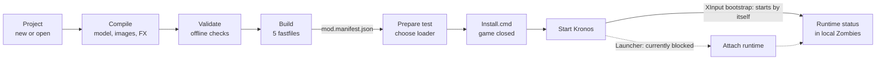

# BO7 Linker 0.9.1 — User Guide

## 1. What BO7 Linker does

BO7 Linker turns source assets (BO3 exports, CAST files, textures) into native Black Ops 7 assets, packs them into fastfiles and prepares a local test with Kronos. It is two separate programs: **bo7-linker** (the command-line engine) and **Asset Workshop** (the graphical interface, which calls the engine).



The top row happens in the linker; the bottom row is the in-game test. The XInput bootstrap is the default loader: the runtime starts with the game and there is nothing to attach. **Test in game** (F9) runs the whole bottom row, build included, in one click (section 8).

What version 0.9.1 can do:

- create an empty project or import an existing BO7 fastfile;
- compile models, animations, opaque materials, images and billboard sprite FX to native BO7;
- validate a project and build its 5 fastfiles, in French (`fra_`) or English (`eng_`), and convert a project from one game language to the other;
- prepare a test installer, install it, start the runtime and read its status, or do all of that with one click (**Test in game**) and take it back out with **Undo test**.

What it never changes by itself: the game folder. Only an installer writes there, after checking and backing up every file: the `Install.cmd` you run yourself, or the same installer run by **Test in game** when you click it.

**Requirements**

| Item | Needed for |
| --- | --- |
| Windows 10/11 x64 | Everything |
| .NET Desktop Runtime 10 | Running the GUI and the engine |
| BO7 cod25 CL29269900, French (validated) or English (supported) | In-game tests |
| Original Kronos v1.41 | In-game tests |
| .NET 10 SDK + Visual Studio 2026 C++ | Rebuilding only |

## 2. Installation and start-up

There is nothing to install: unpack the BO7 Linker folder anywhere outside the game folder (its name does not matter) and double-click **Launch-GUI.cmd**. The header of the window shows the version you are running.

| In the BO7 Linker folder | Contents |
| --- | --- |
| `Launch-GUI.cmd` | Starts the GUI |
| `app\` | The program: `gui\` (Asset Workshop), `linker\` (the `bo7-linker.exe` engine), `profiles\` (compiler profiles) and `runtime\` (the test runtime and its installer). Keep these four together. |
| `examples\` | Sample projects |
| `docs\` | Guides and technical notes, including [building the runtime](docs/build-runtime.md) |
| `source\` | Source code, `build.ps1` and the self-test; builds go to `source\dist\` (see [source/README.md](source/README.md)) |

Your mods are not stored here but in your **mods folder** (section 4). If the GUI shows **Backend missing**, `app\linker\` is no longer next to `app\gui\`.

The GUI remembers the mods folder, the last project, recent projects, the game folder, the last manifest, the chosen loader, the Test in game options and the last one-click test, the folded sections of the sidebar and the interface language. These settings live in `%LocalAppData%\BO7Linker\gui-settings.json`; deleting that file resets them.

## 3. A tour of the interface

The window has five areas: a header, a sidebar of actions, the project card, the asset list and the activity log, with a status bar at the bottom.

- **Header** — the backend version, the compiler target, the game language, the runtime version, and the **English / Français** selector (the GUI restarts in the chosen language).
- **Sidebar** — the everyday actions, grouped as **Project**, **Compile** (in the order a model needs them) and **Build & test**. Two more groups are folded until you click their title: **Manual test** (Prepare test, Runtime status, Attach runtime: the one-click test step by step) and **More tools** (Inspect file, Convert CAST, Import BO3, Import BO7, Change game language). Actions that need an open project are greyed out until one is loaded. Hover any action for a short explanation.
- **Project card** — the path of the `project.bo7.json` file (the drop-down lists recent projects), with **Browse…**, **Reload** and **Show in folder** (opens the mod folder). Under it: the project name, its native asset count, BO3 imports and game language.
- **Assets** — the project's assets, grouped as *Native BO7 assets* and *BO3 imports*. A model is listed with its name before its ID when the mod knows it (the name is what `setmodel` takes in GSC). Type in **Filter assets…** to search by type, name or ID. Right-click a row to copy its ID or model name, or to compile a model or animation with it.
- **Activity** — the log of every backend command: commands in blue, results in grey, successes in green, errors in red. Under an error, a line in amber starting with **→** says what to do about it, in the language of the interface. **Copy** and **Clear** sit in its title bar, and **Cancel** appears there while something runs.
- **Status bar** — the current operation and how long it took. After a build or compilation, **Open output folder** opens the result.

You can also drag a `project.bo7.json` file, or the folder that contains it, onto the window to open it.

**Keyboard shortcuts**

| Keys | Action |
| --- | --- |
| Ctrl+N | New project |
| Ctrl+O | Open project |
| F5 | Reload the project |
| F6 | Validate |
| Ctrl+B | Build fastfiles |
| F9 | Test in game (Shift+click the button for its options) |
| Ctrl+L | Clear the log |

## 4. Create or open a project

Each mod has its own folder, created for you in your **mods folder** (by default `Documents\BO7 Linker\Projects`, changed in the New project window):

| In `<mods folder>\<mod>\` | Contents |
| --- | --- |
| `project\` | The project: `project.bo7.json`, its native assets, the compiler reference data and the fastfile templates. Every compile changes it in place. |
| `build\` | The latest fastfiles and `mod.manifest.json`, replaced by each build or compile |
| `tests\` | One-click tests: their installers and the backups of the game files |
| `history\` | A copy of `project\` from before each compile (the last 20), used by **Undo last change** |
| `scripts\` | Optional: your own GSC scripts, added to every Test in game |
| `models.json` | The names of the models compiled in this mod |

A mod folder can be moved or copied freely.

**Create a project**

1. Click **New project** (Ctrl+N).
2. Enter a name: lowercase letters, digits and underscores, starting with a letter, 48 characters at most (for example `my_weapon`).
3. Optional: **Change…** the mods folder. The mod gets a folder named after the project (with `_2`, `_3`… if it already exists).
4. Choose the **Game language**: French (`fra_`, validated in game) or English (`eng_`, see section 9).
5. Click **Create project**. It opens with 0 native assets.

An empty project can already be built: it gives a main fastfile with zero assets and the four companion fastfiles.

**Open a project**

- **Open project** (Ctrl+O) or **Browse…**, then choose a `project.bo7.json` file;
- pick it from the recent list in the project field;
- or drag the file or its folder onto the window.

To try things out, open `examples\Simple_Room\project.bo7.json`.

**How compilations work.** Each compile action changes the open project in place: you only choose the source files. The previous version is kept in `history\`, and **Undo last change** puts it back (click it again to go further back). The fastfiles of the result go to `build\`.

**Projects from older versions** (not in a `project\` folder of a mod) are copied once into a new mod folder the first time you compile, build or test them. The GUI asks first, and the original stays where it is.

## 5. Import and convert sources

These actions read sources without compiling them to BO7.

| Action | What it does | You provide |
| --- | --- | --- |
| **Import BO7** | Creates a project from an existing custom BO7 fastfile | The `.ff` (stored blocks), its `separation-manifest.json` layout, its native audit JSON, (a mod folder named after the `.ff` is created) |
| **Import BO3** | Adds a BO3 model or animation to the open project as an import; with no project open, exports it as an `.asset.json` file | A `.cast`, `.xmodel_bin` or `.xanim_bin` file |
| **Convert CAST** | Converts a CAST folder (and subfolders) to XModel_BIN v7 / XAnim_BIN v3 files; no project needed | A CAST folder; results go to a new `<folder>_converted` folder next to it |
| **Inspect file** | Prints what a file contains in the log | A `.cast`, `.ff`, `.xmodel_bin` or `.xanim_bin` file |

A BO3 import stays in the *BO3 imports* group with the status *Imported — BO7 encoding required*. It is not native yet: use the compile actions (next section) to produce BO7 assets.

**Convert CAST** keeps the folder structure. Each result comes with a `.castmeta.json` and a `.source.cast`; keep all three together. Referenced textures are copied but are not BO7 images until you compile them.

## 6. Compile BO7 assets

Every compile action needs an open project. It changes the project in place (the previous version goes to `history\`) and writes the five fastfiles and `mod.manifest.json` to `build\`.

**Recommended order for a weapon:** materials first, then the model, then animations, then images or FX. Compiling a model before any materials falls back to the profile's preview material.

### Materials

1. Click **Compile BO7 materials** and choose the `*.materials.json` file exported with the BO3 model.
2. Tick the materials to convert. Opaque materials are ticked by default; emissive and transparent ones are not supported and stay unticked.

Textures can be PNG, TGA or DDS. Colour and normal maps must have the same size. Gloss, normal and occlusion are packed into one NOG texture (R = gloss, G = normal Y, B = occlusion, A = normal X), and both maps are compressed to BC3.

### Model

1. To try a specific BO7 material, first select its `material` row in the asset list. Otherwise source material names must match materials already in the project.
2. Click **Compile BO7 model** and choose a `.cast` or `.xmodel_bin`.
3. In **Model settings**, check the **Model name** (the name scripts use; it is suggested from the file name), set the **Scale factor** (1 keeps the export units) and, if needed, a **Target root bone name**.

Limits: up to 255 bones, one UV layer, eight weights per vertex. Collision is not generated.

### Model names for scripts

A script can only use a model by name (`setmodel`) when the project registers that name. **Test in game** does it by itself, in the test's copy, when **Show a model in front of me** is on, so you rarely need more. To register the names in the project itself, click **Register models** as the last step and enter every model name, one per line: a project holds a single name table, so register all of them at once.

### Animation

1. Optional: select a native `xanim` row first. Its other tracks and notes are kept around the weapon rig.
2. Click **Compile BO7 animation**, choose the BO3 animation (`.cast` or `.xanim_bin`), then the reference model holding the weapon skeleton.
3. Use the **same scale and root bone** as for the model.

Limits: one part, up to 256 frames, a weapon reference skeleton is required, and no arm retargeting.

### Images

1. Click **Compile BO7 images** and select one or more PNG, TGA or DDS files.
2. Choose **Colour map (sRGB)** for albedo, UI and decals, or **Data map (linear)** for masks, normals and gloss.

Each file becomes an image named after the file in lowercase, with spaces and dashes turned into underscores (`UI Icon-01.png` → `ui_icon_01`). Supported: PNG of every kind, TGA (raw or RLE), DDS in RGBA8/BGRA8 or BC1, BC2, BC3, BC4, BC5, BC7. Everything is re-encoded to BC3 with mipmaps. An image only shows in game when a material, UI element or script uses it by name.

### FX

1. Click **Compile BO7 FX** and choose the BO3 effect JSON.
2. Choose the FX source folder (the one holding `materials\` and `images\`).
3. In **FX settings**, set the compiled name, emission duration, opacity, sprite size, particle lifetime, extra spawn delay, atlas frame rate or looping spawn rate. A blank name keeps the generated source name. A duration or frame rate of zero keeps source timing. Percentages multiply the corresponding source values.
The bundled sprite profile is used automatically.

Billboard particles can have a fixed or variable lifetime. The source field `lifeSpanMsec` contains the minimum lifetime and the amplitude in milliseconds. For example, `[500, 250]` gives each particle a lifetime between 0.5 and 0.75 seconds. If an animated atlas uses a variable lifetime, set `atlas.fps` to a positive frame rate.

Particle positions remain fixed. Wind, gravity, collision and spawn volumes are unsupported.

### What is not supported

- **Sounds**: the compiler profile has no example of a BO7 sound asset, so none can be produced yet.
- Emissive and transparent materials, moving particles and FX types beyond billboard sprites, and playable weapon definitions.

## 7. Validate and build fastfiles

**Validate** (F6) checks the open project without writing anything: checksums, paths, dependency order, unsupported imports and the game language. Each problem is listed on its own line in the activity log (errors in red, each with what to do about it) and the status bar gives the count.

**Build fastfiles** (Ctrl+B) writes to the mod's `build\` folder, replacing the previous build:

| File | Role |
| --- | --- |
| `<name>.ff` | Main fastfile with the project's assets |
| `fra_<name>.ff`, `jp_<name>.ff`, `ww_<name>.ff`, `srv_<name>.ff` | The four required companion fastfiles |
| `manifest.json`, `build-report.json` | Build details |
| `mod.manifest.json` | The package description used by Prepare test |

A project with BO3 imports that are not compiled to BO7 is refused: an import is never silently dropped from a build. Every changed build still needs an in-game test.

## 8. Test in game

A build is tested by preparing an installer, running it with the game closed, then starting Kronos and entering local Zombies. Only one package is active per game launch.

### One click: Test in game

**Test in game** (F9) does the whole test for the open project:

1. builds it into the mod's `tests\<date>-test\build`, and adds the GSC scripts: the mod's own `scripts\*.gsc` and, when **Show a model in front of me** is on, the model preview script (see below);
2. waits until BO7 and Kronos are closed: close them and it carries on by itself;
3. removes the previous one-click test, if it is still the latest installation, so the game is never more than one test away from how it was;
4. prepares the installer and runs it, exactly as `Install.cmd` does (same checks, verified backup, rollback on failure);
5. starts Kronos (`KronosLauncher.exe` next to the game folder); with the XInput bootstrap the runtime then starts with the game (with the Launcher loader it would be attached here, see *Choose a loader*);
6. follows the runtime until the engine loads the package or refuses it, and shows the lines of `kronos\Logs\bo7-runtime-loader.log` and `bo7-runtime-import.log` in the activity log as they are written.

The first click asks for the game folder, the loader and whether to start Kronos; tick **Don't show this window again** to skip it, and Shift+click the button to see it again. **Cancel** stops the test at any step except during the installation itself, which always finishes or rolls back.

**Undo test** waits for BO7 and Kronos to close and restores the game files from before the last one-click test, then deletes that test's folder. A test that was cancelled before installing leaves nothing behind. It refuses when another installation was made on top of it: undo that one first with its own `Restore.cmd`.

`engine-loaded` still only means the engine accepted the package: check the asset in game.

**Seeing a model in game.** A compiled model is in the fastfile but nothing places it in the world by itself. With **Show a model in front of me in local Zombies** (on by default, in the Test in game window), the test also:

- registers the project's model names for scripts, in the test's copy only (registration can be done once per project, so the project itself is not changed);
- adds `zm_model_preview.gsc` (from `app\profiles\scripts\`) with the chosen model, which spawns it in front of you a few seconds after you spawn (`level.mp_spawn_delay`).

Kronos custom scripts must be enabled. To change distance, height or rotation, copy `app\profiles\scripts\zm_model_preview.gsc` into the mod's `scripts\` folder and edit it there: a script with that name in `scripts\` is used instead of the generated one. The model's name is the one given when compiling it (the mod keeps it in `models.json`).

The rest of this section is the same test step by step.

### Choose a loader

The runtime that loads your package has to start inside BO7. There are two ways. **XInput bootstrap** is the default and the one that works today; the **Launcher** is kept for when its attach is accepted again:

| | XInput bootstrap (default) | Launcher (currently blocked) |
| --- | --- | --- |
| How the runtime starts | Automatically: Kronos' `XINPUT9_1_0.dll` is replaced by a proxy | Attached to BO7 once Kronos has started it: by **Test in game**, or with **Attach runtime** / `Attach.cmd` |
| Status | Works: the loader behind the results confirmed in game | Windows refuses the attach to BO7 started by Kronos v1.41 (`ATTACH_ACCESS`, access denied), even as administrator |
| Kronos files | Original renamed to `bo7-runtime-original.dll`; **Undo test** / `Restore.cmd` puts it back | Left in place (the original is put back if the proxy was installed) |
| Kronos updates | Kronos lists `XINPUT9_1_0.dll` in its own file manifest and can put it back, which removes the bootstrap: test again to reinstall it | Not affected |
| Runtime needed | Any (bundled 0.3.0) | 0.2 or later (bundled 0.3.0) |

**If the runtime does not start with the XInput bootstrap** (state stays `not-started` and `kronos\Logs\bo7-runtime-loader.log` is not rewritten), Kronos may have put its own `XINPUT9_1_0.dll` back, as it can at start-up or after an update. Run **Test in game** again to reinstall the bootstrap.

**About the Launcher.** When the attach is refused, the GUI asks Windows to run only the attach as administrator (the usual Windows prompt), and `Attach.cmd` starts itself again as administrator. With Kronos v1.41 the attach is refused even then, so the Launcher cannot load a package at the moment. The GUI marks it *currently blocked* and says so when you choose it.

### Prepare and install

1. Click **Prepare test**.
2. **Mod manifest**: the `mod.manifest.json` from your build (filled in automatically after a build).
3. **Game folder**: the BO7 folder containing `cod25-cod.exe`.
4. **Loader**: keep **XInput bootstrap** (see above).
5. Optional: **Verify package** checks the files; **Package with scripts…** makes a copy of the package with the GSC scripts you pick (Kronos custom scripts must be enabled).
6. Click **Prepare installer…**. The installer is written to `tests\<date>-installer` next to the build (in the mod folder for a mod build). Nothing is written to the game at this point.
7. Close BO7 and Kronos, then run **Install.cmd** from the prepared folder. It checks every file, backs up what it replaces, and rolls back on failure.

### Start and check

- **XInput bootstrap**: start Kronos, enter local Zombies.
- **Launcher** (currently blocked): start Kronos as usual, click **Attach runtime** (or run the prepared **Attach.cmd**), then enter local Zombies. Attach waits up to 10 minutes for BO7; **Stop** or **Cancel** ends the wait.

Then open **Runtime status** (in the **Manual test** group) and click **Refresh runtime status**:

| State | Meaning |
| --- | --- |
| `inactive` | No package selected |
| `not-started` | A package is selected but the runtime has not reported; with Launcher, attach it |
| `verifying` | The runtime is checking the files |
| `waiting-zombies` | Files OK, waiting for a Zombies game |
| `publishing` | Package request sent; assets not confirmed |
| `engine-loaded` | The engine loaded the package. Check the asset in game: this does not prove it renders or works |
| `unloaded` | The engine cleared the package during a menu or map change |
| `engine-error` | The engine reported an error; see `kronos\Logs` |
| `refused` | A safety check stopped it; the message says which |
| `stale` | No recent heartbeat; the report shown is old |

### Undo an installation

With the game and Kronos closed, run **Restore.cmd** from the prepared folder. It restores the exact files from before that installation. Undo several installations in reverse order, and keep the prepared folders and their backups.

### Rebuild the runtime

You only need this if the header does not show Runtime 0.3.0, or if you changed the runtime source. Step-by-step guide, with the fixes for common errors: [docs/build-runtime.md](docs/build-runtime.md). In short, close the GUI and, from the BO7 Linker folder, with Visual Studio 2026 C++ (any edition) and the .NET 10 SDK installed:

```powershell
powershell -ExecutionPolicy Bypass -File .\source\build.ps1 -OriginalClientDll "<path to the original Kronos v1.41 DLL>" -Install
```

The DLL is `bo7-runtime-original.dll` in the game folder if the bootstrap is installed, otherwise the game's `XINPUT9_1_0.dll`. The build goes to `source\dist\`, is checked by the self-test, and `-Install` then puts it in `app\` after copying what it replaces to `%LocalAppData%\BO7Linker\backups\`. Afterwards `app\runtime\runtime.json` shows `"patchVersion": "0.3.0"`, `"loaders": ["proxy","launcher"]` and `"languages": ["french","english"]`.

Without `-OriginalClientDll`, the same command rebuilds only the GUI and the engine and leaves `app\runtime\` as it is.

## 9. Languages

The interface language and the game language are independent.

**Interface language.** Pick **English** or **Français** in the header. The GUI restarts in that language and remembers it. Messages coming from the engine (activity log, error codes, JSON results) stay in English.

**Game language.** Each game language has its own fastfile prefix and `force_language.txt` value. A package always holds five fastfiles: the main one, `jp_`, `ww_`, `srv_` and the localized companion of its language.

| Language | Prefix | `force_language.txt` | Status |
| --- | --- | --- | --- |
| French | `fra_` | `french` | Validated in game |
| English | `eng_` | `english` | Supported since 0.8.0, confirmed in game by the user |

The `eng_` companion is built with the rule measured on the French profile: the localized companions share one envelope and differ only by their zone name and by one record id (the asset hash of `<prefix>apothicon_servant`). The same rule rebuilds `jp_` and `ww_` from `fra_` byte for byte.

- **New project** (or `new-project --language english`) creates an English project.
- **Change game language** (or `set-language --project … --language english --out …`) writes a copy of the open project in the other language. Assets and the main fastfile are unchanged; only the localized companion changes. Converting back gives the original French fastfiles byte for byte.
- **Build** then writes `eng_<name>.ff` instead of `fra_<name>.ff`.

Installing an English package needs:

1. **Runtime 0.3.0**, bundled since 0.8.0 (the header shows the runtime version). Runtimes 0.1.1 and 0.2.0 accept French only (`RUNTIME_LANGUAGE_UNSUPPORTED`).
2. **The English language pack of BO7.** On a French install, `eng_global_stream_mp.ff` is an empty placeholder (`RUNTIME_LANGUAGE_PACK_MISSING`). French has a pinned hash; for English, **Prepare test** measures `eng_global_stream_mp.ff` and pins it in that activation, and the runtime checks it again at start-up.
3. **`steam_settings/force_language.txt` set to `english`**, with BO7 closed (`GAME_LANGUAGE_MISMATCH` otherwise). The linker never changes it for you.

To see what an install contains (read-only):

```powershell
.\app\linker\bo7-linker.exe probe-language --game "F:\XboxGames\COD_BO7\cod25"
```

The report lists the forced language and, for each known language, whether its localized global stream is installed and usable.

## 10. Command-line reference

Every GUI action is a `bo7-linker.exe` command, run from the package folder as `.\app\linker\bo7-linker.exe <command> --option value`. Add `--json` for machine-readable output; `help` lists every command. Output folders must be absent or empty.

| Command | Main options | GUI action |
| --- | --- | --- |
| `capabilities` | — | Header pills |
| `languages` | — | New project language list |
| `probe-language` | `--game` | — |
| `new-project` | `--name --out [--language french\|english] [--profile]` | New project |
| `set-language` | `--project --language french\|english --out` | Change game language |
| `project` | `--project` | Open project |
| `import-bo7` | `--ff --layout --audit --out` | Import BO7 |
| `import-bo3` | `--file --project` | Import BO3 |
| `export-bo3` | `--file --out` | Import BO3 (no project open) |
| `convert-cast` | `--input --out` | Convert CAST |
| `inspect` | `--file` | Inspect file |
| `compile-bo7-material` | `--input --project --out [--name …]` | Compile BO7 materials |
| `compile-bo7-model` | `--input --project --out [--material] [--scale] [--root-bone]` | Compile BO7 model |
| `compile-bo7-animation` | `--input --model --project --out [--context] [--scale] [--root-bone]` | Compile BO7 animation |
| `compile-bo7-image` | `--input (repeatable) --project --out [--name …] [--color srgb\|linear]` | Compile BO7 images |
| `compile-bo7-fx` | `--input --sources --profile --project --out [--name --duration --opacity --size --lifetime --delay --atlas-fps --spawn-rate]` | Compile BO7 FX |
| `validate` | `--project` | Validate |
| `build` | `--project --out` | Build fastfiles |
| `inspect-mod` | `--manifest` | Verify package |
| `package-mod` | `--manifest --out --script …` | Package with scripts… |
| `prepare-test` | `--manifest --game --out [--loader proxy\|launcher] [--runtime]` | Prepare installer… |
| `attach` | `--game [--timeout seconds]` | Attach runtime |
| `runtime-status` | `--game` | Refresh runtime status |
| `register-bo7-models` | `--project --out --name (repeatable)` | Register models |
| `generate-room-source` | `--input --out` | — (room test fixture) |

Example, from an empty project to fastfiles:

```powershell
.\app\linker\bo7-linker.exe new-project --name my_mod --out D:\Mods\my_mod
.\app\linker\bo7-linker.exe compile-bo7-image --input D:\Textures\icons --project D:\Mods\my_mod\project.bo7.json --out D:\Mods\step1
.\app\linker\bo7-linker.exe build --project D:\Mods\step1\project\project.bo7.json --out D:\Builds\my_mod
```

## 11. Limits and troubleshooting

All compilers are experimental (`runtimeValidated: false`): a build that validates offline still needs an in-game check. A textured cube and the static room are the only results confirmed in game so far.

In the GUI, most errors are followed by an amber line starting with **→** that says what to do. The table below covers the same cases and a few that have no error code.

| Problem or message | Cause | What to do |
| --- | --- | --- |
| **Backend missing** | `app\linker\` is not next to `app\gui\` | Keep the four folders of `app\` together |
| Actions greyed out | No project open | Open or create a project |
| `build.ps1` cannot be loaded, scripts are disabled | Windows PowerShell policy | Run it with `powershell -ExecutionPolicy Bypass -File …` |
| `LANGUAGE_UNSUPPORTED` | Game language that is not supported | Use French or English; see section 9 |
| `RUNTIME_LANGUAGE_UNSUPPORTED` | English package with runtime 0.1.1 or 0.2.0 | Use the bundled runtime 0.3.0, or rebuild it (section 8) |
| `RUNTIME_LANGUAGE_PACK_MISSING` | `eng_global_stream_mp.ff` is empty: English pack not installed | Install the English language pack of BO7 |
| `GAME_LANGUAGE_MISMATCH` | `force_language.txt` does not match the package language | Set it to `english` (or `french`) with BO7 closed, or use **Change game language** |
| `COMPANION_LANGUAGE_MISMATCH` | Project companions belong to another language | Use **Change game language** rather than editing the project |
| `BO7_MATERIAL_PROFILE_REQUIRED` | Emissive or transparent material selected | Untick it; only opaque materials are supported |
| `BO7_TEXTURE_SIZE` | Colour and normal maps differ in size | Export both at the same resolution |
| `IMAGE_FORMAT`, `DDS_FORMAT` | Unsupported file or DDS format (e.g. BC6H, JPEG) | Convert to PNG, TGA or a supported DDS |
| `BO7_IMAGE_NAME` | File name gives an invalid asset name | Rename the file: lowercase letters, digits, underscores, starting with a letter |
| `RUNTIME_LOADER_UNSUPPORTED`, `ATTACH_UNSUPPORTED` | Launcher chosen with runtime 0.1.1 | Use the bundled runtime 0.3.0, or the XInput bootstrap |
| `ATTACH_LOADER` | The installed package uses the XInput bootstrap | Nothing to attach: it starts by itself |
| `ATTACH_CLIENT_UNSUPPORTED` | The game's `XINPUT9_1_0.dll` is not the original Kronos v1.41 | Reinstall with the Launcher loader, or restore Kronos |
| `ATTACH_ACCESS` (exit code 3) | Windows refuses the attach to BO7 started by Kronos v1.41, even as administrator | Use the XInput bootstrap: Shift+click **Test in game** and choose it as the loader |
| A sidebar action is missing | It is in a folded group | Click **Manual test** or **More tools** at the bottom of the sidebar |
| `RUNTIME_BUSY` | BO7 is still running | Close BO7 and Kronos |
| `RUNTIME_GAME_MISMATCH` | Game or localized fastfiles differ from CL29269900 | A game update needs a new profile |
| `RUNTIME_GSC_DISABLED` | Package has scripts but Kronos GSC is off | Enable custom scripts in Kronos |
| State `refused`, "An installed package script has changed" | A GSC script installed by the package (in `kronos\custom_scripts`) was edited afterwards | Test in game again: it removes the edited script and keeps your version in `edited-scripts\` of the test's installer folder |
| `RUNTIME_FILE_CHANGED` on `kronos/custom_scripts/…` | A package script was edited or deleted in the game after installation | Use Test in game, or `prepare-test --edited-scripts replace`: an edited script is removed with a saved copy, a deleted one is no longer tracked; Undo test or Restore.cmd puts it back |
| Test in game stays at "Waiting: close BO7 and Kronos" | BO7, `cod25` or `KronosLauncher` is still running | Close them; the test carries on by itself |
| Undo test refuses | Another installation was made on top of the one-click test | Undo that installation first with its `Restore.cmd` |
| State stays `not-started` | Runtime never started | Check `kronos\Logs\bo7-runtime-loader.log`: if it was not rewritten at this game start, Kronos put its own `XINPUT9_1_0.dll` back, so run **Test in game** again. With the Launcher, the runtime has to be attached (currently blocked) |

Useful files: `kronos\Logs\bo7-runtime-loader.log` (runtime log), `kronos\runtime\status.json` (current state), `kronos\runtime\installed.json` (what the runtime installed), and `native-*-report.json` next to each compilation.
