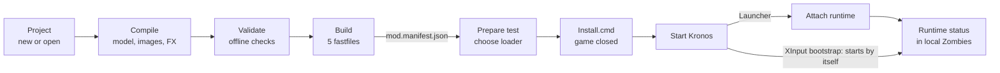

# BO7 Linker 0.9.1 — User Guide

## 1. What BO7 Linker does

BO7 Linker turns source assets (BO3 exports, CAST files, textures) into native Black Ops 7 assets, packs them into fastfiles and prepares a local test with Kronos. It is two separate programs: **bo7-linker** (the command-line engine) and **Asset Workshop** (the graphical interface, which calls the engine).



The top row happens in the linker; the bottom row is the in-game test. With the XInput bootstrap you skip Attach runtime.

What version 0.9.1 can do:

- create an empty project or import an existing BO7 fastfile;
- compile models, animations, opaque materials, images and static billboard FX to native BO7;
- validate a project and build its 5 fastfiles;
- prepare a test installer, install it, start the runtime and read its status.
- Do a quick ingame test

What it never changes by itself: the game folder. Only the `Install.cmd` you run yourself writes there, after checking and backing up every file.

**Requirements**

| Item | Needed for |
| --- | --- |
| Windows 10/11 x64 | Everything |
| .NET Desktop Runtime 10 | Running the GUI and the engine |
| BO7, cod25 CL29269900 | In-game tests (the only validated target) |
| Kronos | In-game tests |
| .NET 10 SDK + Visual Studio 2026 C++ | Rebuilding only (runtime for the Launcher loader) |

## 2. Installation and start-up

There is nothing to install: unpack the `BO7_Linker_v0.91` folder anywhere outside the game folder and double-click **Launch-GUI.cmd**.

Keep the folders together:

| Folder | Contents |
| --- | --- |
| `gui\` | The Asset Workshop GUI (`bo7-linker-gui.exe`) |
| `linker\` | The `bo7-linker.exe` engine, called by the GUI |
| `profiles\` | The CL29269900 compiler profile and the FX sprite profile |
| `runtime\` | The test runtime and its installer (`Deploy.ps1`) |
| `examples\` | Sample projects (`Apothicon_FR`, `Simple_Room`) |
| `docs\` | Technical notes |
| `source\` | Source code and `build.ps1` for rebuilding |

If the GUI shows **Backend missing**, `linker\` is no longer next to `gui\`.

The GUI remembers the last project, recent projects, the game folder, the last manifest, the chosen loader and the interface language. These settings live in `%LocalAppData%\BO7Linker\gui-settings.json`; deleting that file resets them.

## 3. A tour of the interface

The window has five areas: a header, a sidebar of actions, the project card, the asset list and the activity log, with a status bar at the bottom.

- **Header** — the backend version, the compiler target, the game language, the runtime version, and a language selector (Only French and English are available)
- **Sidebar** — every action, grouped as Project, Compile, Check and Build & test. Actions that need an open project are greyed out until one is loaded. Hover any action for a short explanation.
- **Project card** — the path of the `project.bo7.json` file (the drop-down lists recent projects), with **Browse…**, **Reload** and **Show in folder**. Under it: the project name, its native asset count, BO3 imports and game language.
- **Assets** — the project's assets, grouped as *Native BO7 assets* and *BO3 imports*. Type in **Filter assets…** to search by type or ID. Right-click a row to copy its ID, or to compile a model or animation with it.
- **Activity** — the log of every backend command: commands in blue, results in grey, successes in green, errors in red. **Copy** and **Clear** sit in its title bar, and **Cancel** appears there while something runs.
- **Status bar** — the current operation and how long it took.

You can also drag a `project.bo7.json` file, or the folder that contains it, onto the window to open it.

**Keyboard shortcuts**

| Keys | Action |
| --- | --- |
| Ctrl+N | New project |
| Ctrl+O | Open project |
| F5 | Reload the project |
| F6 | Validate |
| Ctrl+B | Build fastfiles |
| Ctrl+L | Clear the log |

## 4. Create or open a project

A project is a folder holding `project.bo7.json`, its native assets, a copy of the compiler reference data and the fastfile templates. It can be moved freely.

**Create a project**

1. Click **New project** (Ctrl+N).
2. Enter a name: lowercase letters, digits and underscores, starting with a letter, 48 characters at most (for example `my_weapon`).
3. Choose a new or empty **Project folder**.
4. Choose desired language (only french and english are available)
5. Click **Create project**.

An empty project can already be built: it gives a main fastfile with zero assets and the four companion fastfiles.

**Open a project**

- **Open project** (Ctrl+O) or **Browse…**, then choose a `project.bo7.json` file;
- pick it from the recent list in the project field;
- or drag the file or its folder onto the window.

To try things out, open `examples\Apothicon_FR\project.bo7.json`.

**How compilations work.** Each compile action writes a *new* project plus its fastfiles into an empty folder you choose, then opens that new project. The previous project is never changed, so each step can be compared or thrown away. Chain steps by compiling into a new folder from the project the last step opened.

## 5. Import and convert sources

These actions read sources without compiling them to BO7.

| Action | What it does | You provide |
| --- | --- | --- |
| **Import BO7** | Creates a project from an existing custom BO7 fastfile | The `.ff` (stored blocks), its `separation-manifest.json` layout, its native audit JSON, an empty folder |
| **Import BO3** | Adds a BO3 model or animation to the open project as an import; with no project open, exports it as an `.asset.json` file | A `.cast`, `.xmodel_bin` or `.xanim_bin` file |
| **Convert CAST** | Converts a CAST folder (and subfolders) to XModel_BIN v7 / XAnim_BIN v3 files; no project needed | A CAST folder, an empty output folder outside it |
| **Inspect file** | Prints what a file contains in the log | A `.cast`, `.ff`, `.xmodel_bin` or `.xanim_bin` file |

A BO3 import stays in the *BO3 imports* group with the status *Imported — BO7 encoding required*. It is not native yet: use the compile actions (next section) to produce BO7 assets.

**Convert CAST** keeps the folder structure. Each result comes with a `.castmeta.json` and a `.source.cast`; keep all three together. Referenced textures are copied but are not BO7 images until you compile them.

## 6. Compile BO7 assets

Every compile action needs an open project and an empty output folder. It writes `project\` (the new project) and `fastfiles\` (its five fastfiles and `mod.manifest.json`), plus a report, then opens the new project.

**Recommended order for a weapon:** materials first, then the model, then animations, then images or FX. Compiling a model before any materials falls back to the profile's preview material.

### Materials

1. Click **Compile BO7 materials** and choose the `*.materials.json` file exported with the BO3 model.
2. Tick the materials to convert. Opaque materials are ticked by default; emissive and transparent ones are not supported and stay unticked.
3. Choose the output folder.

Textures can be PNG, TGA or DDS. Colour and normal maps must have the same size. Gloss, normal and occlusion are packed into one NOG texture (R = gloss, G = normal Y, B = occlusion, A = normal X), and both maps are compressed to BC3.

### Model

1. To try a specific BO7 material, first select its `material` row in the asset list. Otherwise source material names must match materials already in the project.
2. Click **Compile BO7 model** and choose a `.cast` or `.xmodel_bin`.
3. In **Model scale and attachment**, set the **Scale factor** (1 keeps the export units) and, if needed, a **Target root bone name**.
4. Choose the output folder.

Limits: up to 255 bones, one UV layer, eight weights per vertex. Collision is not generated.

### Animation

1. Optional: select a native `xanim` row first. Its other tracks and notes are kept around the weapon rig.
2. Click **Compile BO7 animation**, choose the BO3 animation (`.cast` or `.xanim_bin`), then the reference model holding the weapon skeleton.
3. Use the **same scale and root bone** as for the model.
4. Choose the output folder.

Limits: one part, up to 256 frames, a weapon reference skeleton is required, and no arm retargeting.

### Images

1. Click **Compile BO7 images** and select one or more PNG, TGA or DDS files.
2. Choose **Colour map (sRGB)** for albedo, UI and decals, or **Data map (linear)** for masks, normals and gloss.
3. Choose the output folder.

Each file becomes an image named after the file in lowercase, with spaces and dashes turned into underscores (`UI Icon-01.png` → `ui_icon_01`). Supported: PNG of every kind, TGA (raw or RLE), DDS in RGBA8/BGRA8 or BC1, BC2, BC3, BC4, BC5, BC7. Everything is re-encoded to BC3 with mipmaps. An image only shows in game when a material, UI element or script uses it by name.

### FX

1. Click **Compile BO7 FX** and choose the BO3 effect JSON.
2. Choose the FX source folder (the one holding `materials\` and `images\`).
3. Choose the output folder. The bundled sprite profile is used automatically.
4. Adjust various settings

Limits: static billboards only, with no movement, wind, gravity, collision or spawn volume.

### What is not supported

- **Sounds**: the compiler profile has no example of a BO7 sound asset, so none can be produced yet.
- Emissive and transparent materials, animated FX, playable weapon definitions (a compiled model does not become a usable weapon by itself).

## 7. Validate and build fastfiles

**Validate** (F6) checks the open project without writing anything: checksums, paths, dependency order, unsupported imports and the game language. Errors appear in red in the activity log.

**Build fastfiles** (Ctrl+B) asks for an empty output folder and writes:

| File | Role |
| --- | --- |
| `<name>.ff` | Main fastfile with the project's assets |
| `fra_<name>.ff`, `jp_<name>.ff`, `ww_<name>.ff`, `srv_<name>.ff` | The four required companion fastfiles |
| `manifest.json`, `build-report.json` | Build details |
| `mod.manifest.json` | The package description used by Prepare test |

A project with BO3 imports that are not compiled to BO7 is refused: an import is never silently dropped from a build. Every changed build still needs an in-game test.

## 8. Test in game

You can test fairly esaily by pressing **"Test in Game"** button

### Choose a loader

The runtime that loads your package has to start inside BO7. There are two ways:

| | XInput bootstrap | Launcher (Kronos unchanged but curently blocked by privileges) |
| --- | --- | --- |
| How the runtime starts | Automatically: Kronos' `XINPUT9_1_0.dll` is replaced by a proxy | You click **Attach runtime** once Kronos has started BO7 |
| Kronos files | Original renamed to `bo7-runtime-original.dll` | Left in place (restored if the proxy was installed) |
| Runtime needed | Bundled 0.1.1 | Rebuilt 0.2.0 (see below) |

With the bundled runtime, only the XInput bootstrap works. The Launcher choice is refused with `RUNTIME_LOADER_UNSUPPORTED` until you rebuild the runtime.

### Prepare and install

1. Click **Prepare test**.
2. **Mod manifest**: the `mod.manifest.json` from your build (filled in automatically after a build).
3. **Game folder**: the BO7 folder containing `cod25-cod.exe`.
4. **Loader**: XInput bootstrap or Launcher.
5. Optional: **Verify package** checks the files; **Package with scripts…** makes a copy of the package with the GSC scripts you pick (Kronos custom scripts must be enabled).
6. Click **Prepare installer…** and choose an empty folder outside the game. Nothing is written to the game at this point.
7. Close BO7 and Kronos, then run **Install.cmd** from the prepared folder. It checks every file, backs up what it replaces, and rolls back on failure.

### Start and check

- **XInput bootstrap**: start Kronos, enter local Zombies.
- **Launcher**: start Kronos as usual, click **Attach runtime** (or run the prepared **Attach.cmd**), then enter local Zombies. Attach waits up to 10 minutes for BO7; **Stop** or **Cancel** ends the wait.

Then open **Runtime status** and click **Refresh runtime status**:

| State | Meaning |
| --- | --- |
| `inactive` | No package selected |
| `not-started` | A package is selected but the runtime has not reported; with Launcher, attach it |
| `verifying` | The runtime is checking the files |
| `waiting-zombies` | Files OK, waiting for a Zombies game |
| `publishing` | Package request sent; assets not confirmed |
| `engine-loaded` | The engine loaded the package. Check the asset in game: this does not prove it renders or works |
| `unloaded` | The engine cleared the package during a menu or map change |
| `engine-error` | The engine reported an error; see `kronos\Logs` |
| `refused` | A safety check stopped it; the message says which |
| `stale` | No recent heartbeat; the report shown is old |

### Undo an installation

With the game and Kronos closed, run **Restore.cmd** from the prepared folder. It restores the exact files from before that installation. Undo several installations in reverse order, and keep the prepared folders and their backups.

### Rebuild the runtime for the Launcher loader

From the `BO7_Linker_v0.91` folder, with Visual Studio 2026 C++ installed:

```powershell
powershell -ExecutionPolicy Bypass -File .\source\build.ps1 -Output .\rebuilt -OriginalClientDll "<path to the original Kronos v1.41 DLL>" -Install
```

The DLL is `XINPUT9_1_0.dll` in the game folder if the bootstrap is installed, otherwise the game's `XINPUT9_1_0.dll`. Then back up `runtime\` and copy `rebuilt\runtime\*` into it. Its `runtime.json` must show `"patchVersion": "0.2.0"` and `"loaders": ["proxy","launcher"]`.

## 9. Languages

The interface language and the game language are independent.

**Interface language.** Pick **English** or **Français** in the header. The GUI restarts in that language and remembers it. Messages coming from the engine (activity log, error codes, JSON results) stay in English.

**Game language.** Each game language has its own fastfile prefix, `force_language.txt` value and reference files. French (`fra_`) is the only validated language: projects, builds and installers require it. English (`eng_`) is listed in **New project** but refused until it has been measured on an English install.

To help add a language, run on an install in that language (read-only):

```powershell
.\linker\bo7-linker.exe probe-language --game "F:\XboxGames\COD_BO7\cod25"
```

The report lists the forced language, the localized `*_global_stream_mp.ff` files and their hashes. Adding a language also needs a mod fastfile set built for it (for its companion template) and a runtime rebuild.

## 10. Command-line reference

Every GUI action is a `bo7-linker.exe` command, run from the package folder as `.\linker\bo7-linker.exe <command> --option value`. Add `--json` for machine-readable output; `help` lists every command. Output folders must be absent or empty.

| Command | Main options | GUI action |
| --- | --- | --- |
| `capabilities` | — | Header pills |
| `languages` | — | New project language list |
| `probe-language` | `--game` | — |
| `new-project` | `--name --out [--language french] [--profile]` | New project |
| `project` | `--project` | Open project |
| `import-bo7` | `--ff --layout --audit --out` | Import BO7 |
| `import-bo3` | `--file --project` | Import BO3 |
| `export-bo3` | `--file --out` | Import BO3 (no project open) |
| `convert-cast` | `--input --out` | Convert CAST |
| `inspect` | `--file` | Inspect file |
| `compile-bo7-material` | `--input --project --out [--name …]` | Compile BO7 materials |
| `compile-bo7-model` | `--input --project --out [--material] [--scale] [--root-bone]` | Compile BO7 model |
| `compile-bo7-animation` | `--input --model --project --out [--context] [--scale] [--root-bone]` | Compile BO7 animation |
| `compile-bo7-image` | `--input (repeatable) --project --out [--name …] [--color srgb\|linear]` | Compile BO7 images |
| `compile-bo7-fx` | `--input --sources --profile --project --out [--duration]` | Compile BO7 FX |
| `validate` | `--project` | Validate |
| `build` | `--project --out` | Build fastfiles |
| `inspect-mod` | `--manifest` | Verify package |
| `package-mod` | `--manifest --out --script …` | Package with scripts… |
| `prepare-test` | `--manifest --game --out [--loader proxy\|launcher] [--runtime]` | Prepare installer… |
| `attach` | `--game [--timeout seconds]` | Attach runtime |
| `runtime-status` | `--game` | Refresh runtime status |
| `generate-room-source`, `register-bo7-models` | see `help` | — (room test fixture) |

Example, from an empty project to fastfiles:

```powershell
.\linker\bo7-linker.exe new-project --name my_mod --out D:\Mods\my_mod
.\linker\bo7-linker.exe compile-bo7-image --input D:\Textures\icons --project D:\Mods\my_mod\project.bo7.json --out D:\Mods\step1
.\linker\bo7-linker.exe build --project D:\Mods\step1\project\project.bo7.json --out D:\Builds\my_mod
```

## 11. Limits and troubleshooting

All compilers are experimental (`runtimeValidated: false`): a build that validates offline still needs an in-game check. A textured cube and the static room are the only results confirmed in game so far.

| Problem or message | Cause | What to do |
| --- | --- | --- |
| **Backend missing** | `linker\` is not next to `gui\` | Keep the package folders together |
| Actions greyed out | No project open | Open or create a project |
| `build.ps1` cannot be loaded, scripts are disabled | Windows PowerShell policy | Run it with `powershell -ExecutionPolicy Bypass -File …` |
| `LANGUAGE_UNSUPPORTED` | Game language other than French | Use French; see section 9 |
| `BO7_MATERIAL_PROFILE_REQUIRED` | Emissive or transparent material selected | Untick it; only opaque materials are supported |
| `BO7_TEXTURE_SIZE` | Colour and normal maps differ in size | Export both at the same resolution |
| `IMAGE_FORMAT`, `DDS_FORMAT` | Unsupported file or DDS format (e.g. BC6H, JPEG) | Convert to PNG, TGA or a supported DDS |
| `BO7_IMAGE_NAME` | File name gives an invalid asset name | Rename the file: lowercase letters, digits, underscores, starting with a letter |
| `RUNTIME_LOADER_UNSUPPORTED`, `ATTACH_UNSUPPORTED` | Launcher chosen with runtime 0.1.1 | Rebuild the runtime (section 8) or use the XInput bootstrap |
| `ATTACH_LOADER` | The installed package uses the XInput bootstrap | Nothing to attach: it starts by itself |
| `ATTACH_CLIENT_UNSUPPORTED` | The game's `XINPUT9_1_0.dll` is not the original Kronos v1.41 | Reinstall with the Launcher loader, or restore Kronos |
| `ATTACH_ACCESS` | The game runs with higher rights than the GUI | Run the GUI as administrator only if the game is |
| `RUNTIME_BUSY` | BO7 is still running | Close BO7 and Kronos |
| `RUNTIME_GAME_MISMATCH` | Game or French fastfiles differ from CL29269900 | A game update needs a new profile |
| `RUNTIME_GSC_DISABLED` | Package has scripts but Kronos GSC is off | Enable custom scripts in Kronos |
| State stays `not-started` | Runtime never started | With Launcher, click Attach runtime; otherwise check `kronos\Logs\bo7-runtime-loader.log` |

Useful files: `kronos\Logs\bo7-runtime-loader.log` (runtime log), `kronos\runtime\status.json` (current state), `kronos\runtime\installed.json` (what the runtime installed), and `native-*-report.json` next to each compilation.

## 12. Other thing(s)

You can add various files type that aren't present in the GUI, at your own risk. (Not tested)
 1. Scriptbundles
 2. Animpkg
 3. Netconststrings
 4. Weapon
 5. Vfxpkg
 6. Weapontunables
And more...


